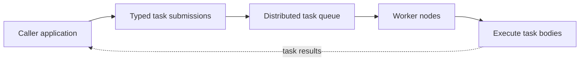
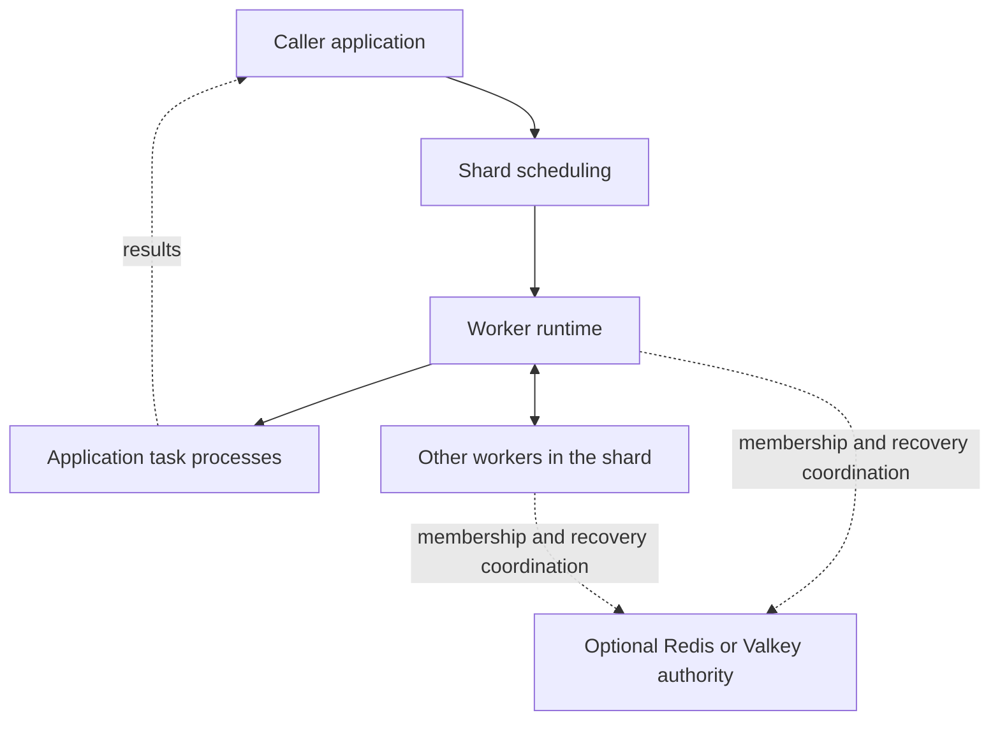

# Kabudachi

Kabudachi is a peer-to-peer distributed task queue for Python applications. It lets you declare work as typed Python functions, run it across worker processes, and choose how that work behaves when workers fail or newer requests arrive.

Use it for background jobs, parallel batch processing, and repeated updates where only the latest pending request matters. Python provides the application API; Rust coordinates scheduling, workers, and recovery.

## What you can do

- Declare synchronous or asynchronous tasks with one typed input and a typed result.
- Run locally with awaitable results, sequential flows, parallel groups, and maps.
- Set retries, timeouts, delayed starts, and expiry for pending work.
- Choose recoverable tasks, best-effort tasks, or tasks that combine pending updates by key.
- Run networked workers that share work and recover from worker or leader loss.



## Callers and workers

Callers submit tasks and receive results. Workers execute tasks. These are separate roles: a caller does not start a worker, and a worker does not act as a caller. `kabudachi.run()` belongs to the worker entry point.

The current runtime mixes these roles and lacks remote-result delivery. The diagram above shows the intended system model; the gaps below describe where the code does not yet meet it.

## Run a worker

`kabudachi.run()` is the worker-node entry point and requires no arguments. Import your application task module before starting it:

```python
import kabudachi
import my_tasks

if __name__ == "__main__":
    kabudachi.run()
```

Use the [worker setup guide](docs/getting-started.md#start-networked-workers) to configure networked workers.

## Define a task

Tasks are typed Python functions. The default serializer accepts protobuf messages, lists of messages, and `None`:

```python
import kabudachi
from google.protobuf.wrappers_pb2 import StringValue

@kabudachi.task
async def greet(request: StringValue) -> StringValue:
    return StringValue(value=f"Hello, {request.value}!")
```

Put task definitions in an importable module that workers load. Callers should submit tasks and await their results independently of worker startup. The current implementation does not yet support that complete production workflow; see the gaps below.

## Choose the right kind of work

| Task kind | Behavior | Example use |
| --- | --- | --- |
| `@task` | Replays work after the worker running it is lost | Generate a report or process an uploaded file |
| `@ephemeral_task` | Does not replay a run lost with its worker | Send a disposable progress update |
| `@coalescing_task` | Replaces older pending submissions with the same key; one generation of a key runs at a time | Refresh a search document or rebuild a cached view |

Coalescing keeps a running generation intact. By default, the newest pending payload wins; an optional merge function combines retained payloads. See [Use cases](docs/use-cases.md) for diagrams and examples.

## Basic architecture

A **caller** is an application that submits tasks and receives results. A **worker** is a process that executes application tasks. A **shard** is a group of workers coordinating the same work. One worker leads scheduling at a time; workers share task records so a replacement leader can reconstruct the work still outstanding.



Redis or Valkey supplies coordination when configured. Task records live with workers; the authority is not a task broker. See [Architecture and contributing](docs/architecture.md) for the component map and development checks.

## Gaps against the system model

Workers should run through `kabudachi.run()` with no required arguments. Callers and workers must remain separate roles, and task handles must return results from remote workers.

| Architectural gap | Current behavior | User impact |
| --- | --- | --- |
| Function-accepting worker entry point | `kabudachi.run(main)` accepts and executes a caller function | Test-only behavior is exposed through the production API; the worker entry point should be `kabudachi.run()` |
| Remote-result delivery gap | Awaiting a networked task handle raises `RemoteResultUnavailableError` | Callers cannot receive remote results; tasks that await remote child tasks fail |
| Caller and worker roles are combined | Calling a task without an active worker runtime raises `RuntimeNotStartedError` | The runtime does not yet provide the required independent caller role |
| Missing `.reduce` API (Phase 6 defect) | The public Python task API has no `.reduce` | Reduction is unavailable and blocks Phase 6 functional completeness |

No-argument worker startup is already supported. Independent callers and remote-result delivery are core requirements of the distributed queue. **Phase 6 remains incomplete** until its [functional-completeness gate](docs/implementation-phases.md#functional-completeness-exit-gate) is met; production readiness is a separate gate.

`run(main)` is a defect, not a supported production integration pattern: it exposes test-only code at the production boundary. Writing networked outputs to an application-owned destination can temporarily work around missing remote results, but does not resolve caller and worker separation.

Recovery can run a task body again. Make external effects safe to repeat, for example by using an application job ID when writing a report or updating a database. Completion certification does not make external effects happen exactly once.

Each submission creates a distinct task; retrying a submission does not deduplicate it. Coalescing replaces pending generations by key rather than making submission idempotent.

Recovery restarts the task body from the beginning. Application code owns any checkpoints for long-running work.

Task records are held in worker memory. Recovery from individual failures depends on surviving workers retaining the required records; this is not disk-backed recovery after every worker stops.

## Documentation

- [Getting started](docs/getting-started.md): source setup, the first task, and worker configuration.
- [Use cases](docs/use-cases.md): batch work, pipelines, repeated updates, and background jobs.
- [Architecture and contributing](docs/architecture.md): concepts, component responsibilities, and checks for contributors.
