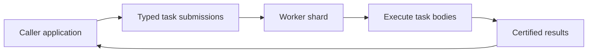
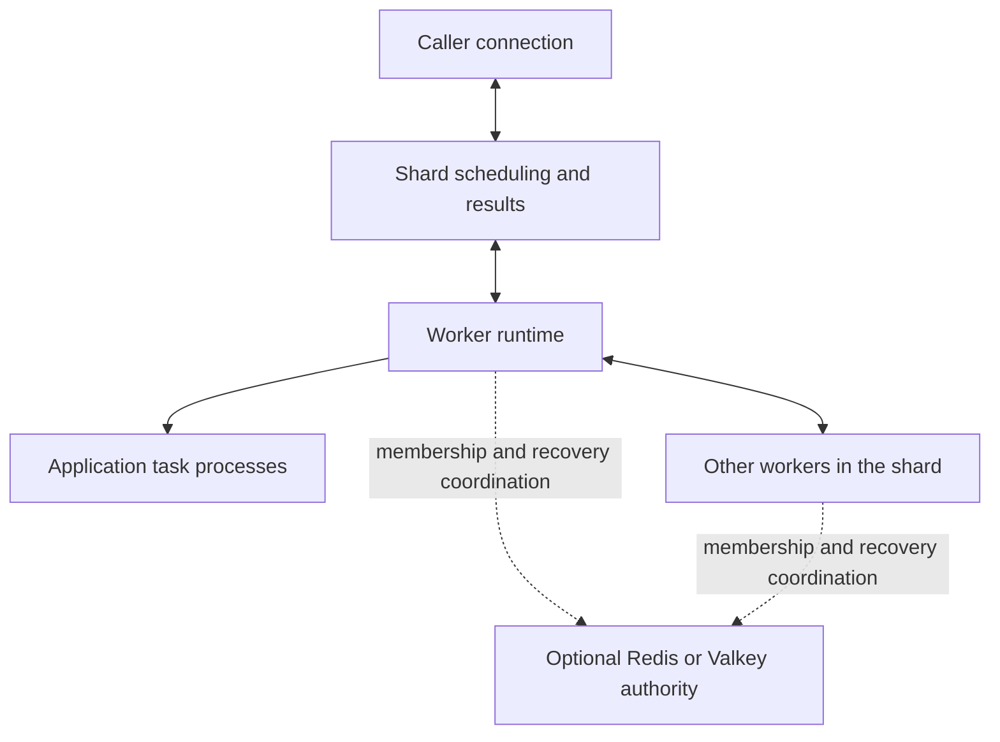

# Kabudachi

Kabudachi is a peer-to-peer distributed task queue for Python applications. Declare work as typed Python functions, submit it to workers, and await the results. Python provides the application API; Rust coordinates scheduling, workers, and recovery.

Use it for background jobs, parallel batch processing, multi-stage transformations, and repeated updates where only the latest pending request matters.

## What you can do

- Declare synchronous or asynchronous tasks with typed inputs and results.
- Submit work from an independent caller and receive results from remote workers.
- Compose tasks with sequential flows, parallel groups, maps, and reductions.
- Set retries, timeouts, delayed starts, and expiry for pending work.
- Choose recoverable tasks, best-effort tasks, or tasks that combine pending updates by key.
- Route work to named queues and recover from worker or leader loss.
- Inspect task status and recover retained results by ID with a configured result backend.



## Callers and workers

Callers submit tasks and receive results. Workers execute tasks. A caller connection starts no task processes and does not participate in worker membership or voting.

`kabudachi.run()` starts a worker and takes no arguments. Callers need no Kabudachi setup or teardown calls: the first task call initializes the connection, and its internal owner releases resources when collected or when the process exits. Call a task directly with `await task(input)` or synchronously with `task.s(input)`.

Connection settings come from application configuration or environment variables. An explicit `kabudachi.client(...)` context remains available when an application wants to bound a connection's lifetime.

## Define a task

Put task definitions in an importable module, such as `my_tasks.py`:

```python
import kabudachi
from google.protobuf.wrappers_pb2 import StringValue

@kabudachi.task
async def greet(request: StringValue) -> StringValue:
    return StringValue(value=f"Hello, {request.value}!")
```

The default serializer accepts protobuf messages, lists of messages, and `None`. Dataclass and optional Pydantic serializers are also available. Callers and workers must load compatible task definitions and serializers.

## Run a worker

Save this as `worker.py`:

```python
import kabudachi
import my_tasks

if __name__ == "__main__":
    kabudachi.run()
```

After [building from source](docs/getting-started.md#build-from-source), start a worker listening on a known local address:

```sh
KABUDACHI_LISTEN=/ip4/127.0.0.1/tcp/4001 runtime/.venv/bin/python worker.py
```

## Call tasks

Call tasks directly, using the same imported task definition as the worker:

```python
from google.protobuf.wrappers_pb2 import StringValue
from my_tasks import greet

# Inside an async application:
result = await greet(StringValue(value="world"))

# Or from synchronous application code:
result = greet.s(StringValue(value="world"))
```

Both forms return the worker's certified result and propagate remote errors without a caller connection call or context manager. Use `.s(...)` from synchronous application code; use `await` on an event-loop thread. Initialization happens on the first task call, and the internally owned connection outlives individual application event loops.

For a synchronous caller, save the imports, the `greet.s(...)` call, and `print(result.value)` in `caller.py`, then connect it to the worker above:

```sh
KABUDACHI_SEEDS=/ip4/127.0.0.1/tcp/4001 runtime/.venv/bin/python caller.py
```

## Choose the right kind of work

| Task kind | Behavior | Example use |
| --- | --- | --- |
| `@task` | Replays work after worker loss by default | Generate a report or process an uploaded file |
| `@ephemeral_task` | Does not replay a run lost with its worker | Send a disposable progress update |
| `@coalescing_task` | Replaces older pending submissions with the same key; one generation of a key runs at a time | Refresh a search document or rebuild a cached view |

Coalescing keeps a running generation intact. By default, the newest pending payload wins; an optional merge function combines retained payloads. For ordinary tasks that must not replay after an uncertain execution, use `retriable=False`; worker loss can then leave the task orphaned rather than execute it again.

Use `@kabudachi.reducer` and `.reduce(...)` to fold a list into one result. See [Use cases](docs/use-cases.md) for examples of reductions, maps, groups, and flows across workers.

## Basic architecture

A **shard** is a group of workers coordinating the same work. One worker leads scheduling at a time; workers share task records so a replacement leader can reconstruct unfinished work. Callers connect to the shard without joining its worker fleet.



Redis or Valkey supplies coordination when configured; it is not the task broker. An optional result backend retains certified results for later lookup. See [Architecture and contributing](docs/architecture.md) for the component map and development checks.

## Caller API guarantees

| Behavior | Implementation |
| --- | --- |
| Automatic connection | The first task call initializes connection resources from process configuration |
| Automatic cleanup | The internal owner's finalizer releases its transport and loop without manual teardown |
| Synchronous `.s(...)` | Submit and receive the certified result directly from synchronous application code |

Remote task results, the no-argument worker entry point, reductions, and implicit callers are implemented. One comprehensive installed-wheel acceptance scenario exercises caller APIs without a connection context across five workers, including worker and leader loss. Production readiness remains a separate gate covering Phases 7/8 and final rigorous testing.

## Execution and recovery

Recovery can run a task body again. Make external effects safe to repeat, for example by using an application job ID when writing a report or updating a database. Completion certification does not make external effects happen exactly once.

Each submission creates a distinct task; retrying a submission does not deduplicate it. Coalescing replaces pending generations by key rather than making submission idempotent.

Recovery restarts the task body from the beginning. Application code owns any checkpoints for long-running work. Live task recovery depends on surviving worker records. A result backend retains completed outputs; it does not restore all unfinished work after every worker stops.

## Documentation

- [Getting started](docs/getting-started.md): source setup, workers, caller connections, and configuration.
- [Use cases](docs/use-cases.md): batch work, pipelines, reductions, repeated updates, and background jobs.
- [Architecture and contributing](docs/architecture.md): concepts, component responsibilities, and checks for contributors.
