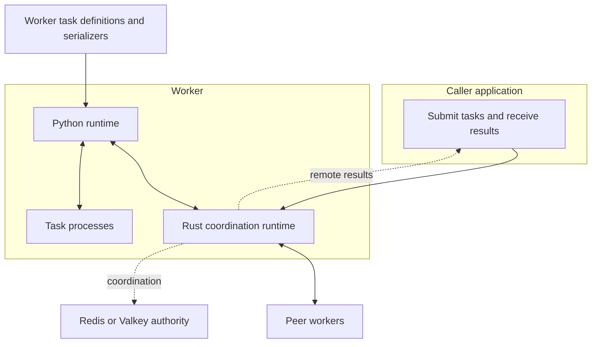
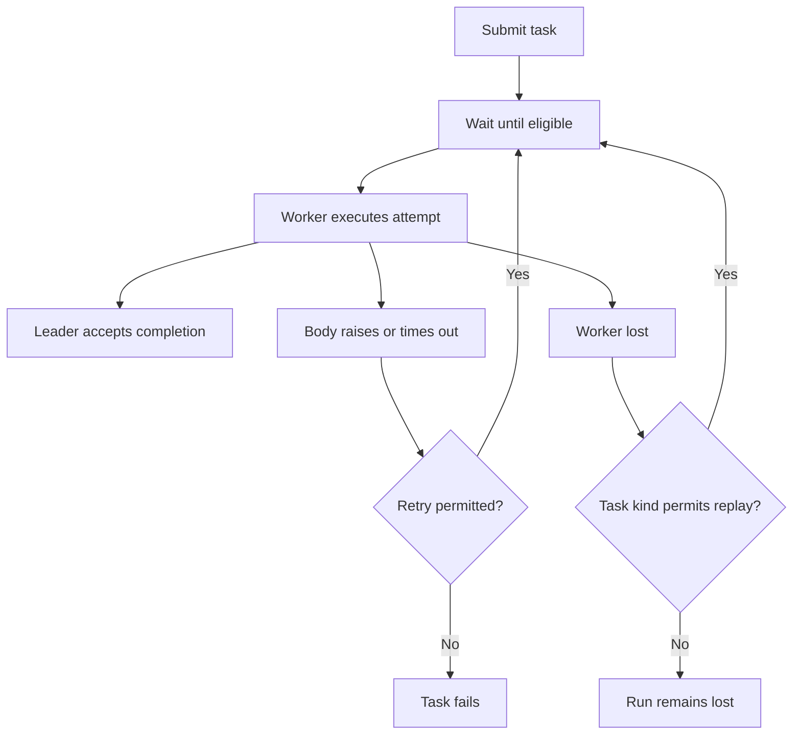
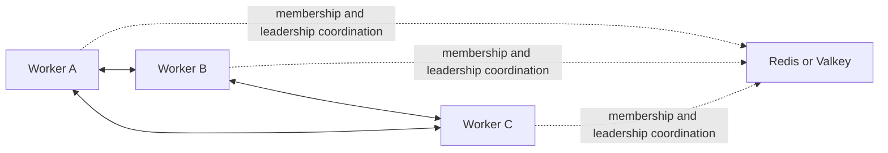
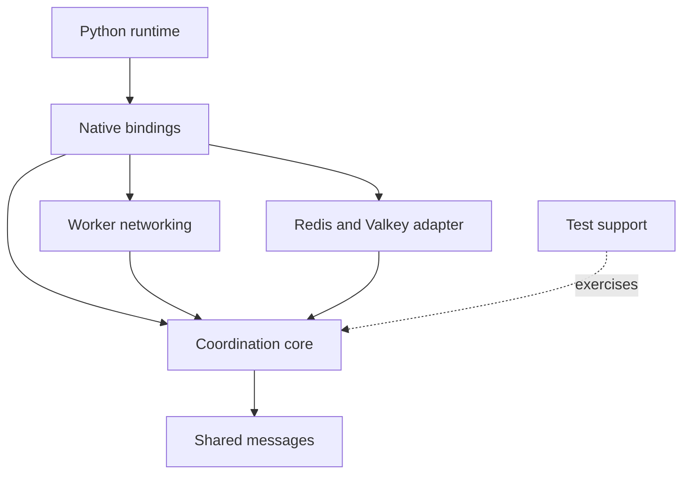

# Architecture and contributing

Kabudachi separates application work from the coordination needed to distribute it. Python defines and runs task bodies. Rust manages scheduling, worker membership, task records, and recovery.

## Local and networked execution

A local run hosts a single worker and delivers results to Python handles. Task bodies normally run in child processes; `processes=0` keeps them in the host process for small examples and experiments.

`kabudachi.run()` with no arguments is the worker-node entry point. A networked worker joins a shard: workers that share scheduling and recovery. One worker leads the shard at a time, and workers execute tasks assigned through the shard.

Callers submit tasks and receive results. Workers execute tasks. A worker is never a caller, and a caller is never a worker. The current runtime combines these roles and does not deliver remote results; those are gaps against this core architecture. Its function-accepting `run(main)` entry point is a separate defect: test-only behavior is exposed at the production boundary. The production worker entry point should accept no function.



The diagram shows the intended separation of caller and worker roles; the current combined API does not yet provide that separation or remote-result delivery.

Every worker needs compatible application tasks and serializers. The shard shares task data and coordination; it does not distribute your application code.

## Work and recovery

A submission describes a task and its input. An execution attempt runs that body. The leader accepts completion reports for the work it coordinates. Ordinary tasks can receive another attempt after worker loss; ephemeral tasks do not replay a lost run.



Workers retain task records and share them with peers. A replacement leader uses surviving records and worker reports to rebuild its view of unfinished work. A configured Redis or Valkey authority helps workers find the shard and coordinate recovery and leadership.



The authority serves coordination rather than holding the task queue. Task records are held in worker memory, so surviving copies matter during recovery. Applications should store lasting outputs in their own systems and make external effects safe to repeat.

## Contributor map

| Area | Responsibility |
| --- | --- |
| `runtime/` | Python task API, composition, process execution, and lifecycle hooks |
| `bindings/` | Native extension connecting Python execution to Rust coordination |
| `core/` | Scheduling, membership, leadership, and recovery rules |
| `net/` | Worker communication, discovery, and sharing task records |
| `redis_authority/` | Redis and Valkey coordination support |
| `proto/` | Shared message definitions |
| `testkit/` | Reusable test support for coordination and failures |



Start in `runtime/` for changes to how users declare, submit, and compose tasks. Start in `core/` for coordination behavior and `net/` for interactions between workers. Keep user-facing descriptions focused on observable behavior; use source and tests for detailed protocol rules.

## Development checks

Follow [Getting started](getting-started.md) to prepare a source checkout. Bazel builds and tests the mixed Python and Rust project:

```sh
bazel test //...
```

For a focused Python API check:

```sh
bazel test //runtime/tests:test_declaration //runtime/tests:test_composition //runtime/tests:test_run
```

For a quick Rust compile check, with a Rust toolchain installed:

```sh
cargo check --workspace --all-targets
```

The repository also supplies a development container. To run the Bazel suite in that environment:

```sh
docker build -t kabudachi-dev .
docker run --rm kabudachi-dev bazel test //...
```

Choose checks that exercise the behavior you change. For documentation changes, verify examples against the current API and keep diagram labels consistent with the surrounding prose.

## Gaps against the core architecture

Remote-result delivery is missing: local handles deliver results, but networked handles raise `RemoteResultUnavailableError` when awaited. This also breaks tasks that await remote child tasks and prevents the documented local composition patterns from working across networked workers.

The current runtime combines caller and worker roles: calling a task without an active runtime raises `RuntimeNotStartedError`, while starting that runtime also starts a worker. The core model requires distinct callers and workers. No-argument `kabudachi.run()` already serves the worker-entry-point requirement; an independent caller role remains missing.

Accepting a function in `kabudachi.run(main)` is a production API defect. It exposes test-only behavior and mixes caller execution with worker startup. Keep that behavior behind a test boundary rather than presenting it as a production caller API. External output storage works around missing remote results. Keep caller and worker roles separate when describing the intended system.

Completion tracking does not make external effects happen exactly once. Worker recovery depends on surviving task records. Keep these limits explicit when describing new use cases or extending the guides.

The [implementation phases and status](implementation-phases.md) preserve the historical roadmap, completion notes, outstanding discrepancies, and production-readiness gates.
