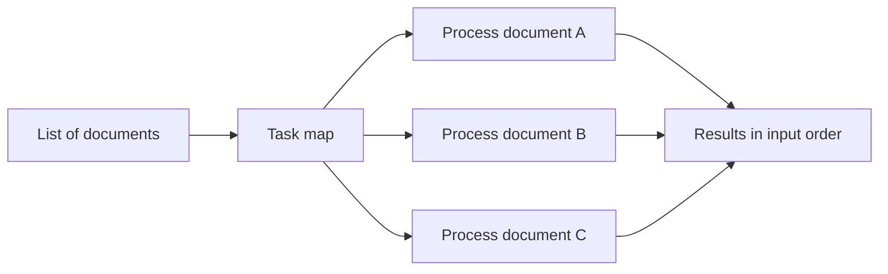
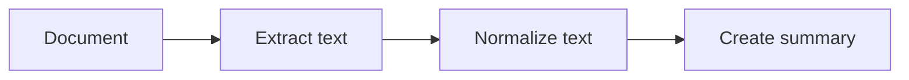
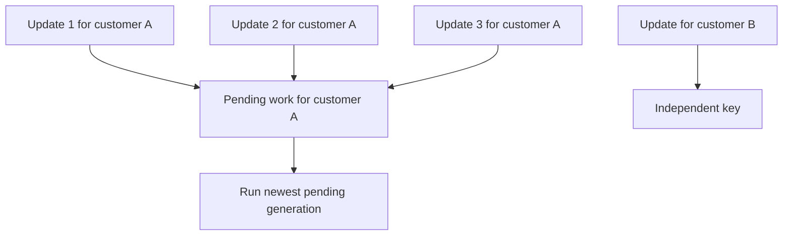
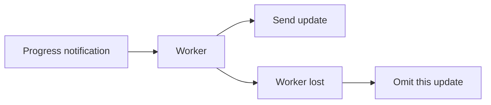

# Use cases

These patterns show where Kabudachi's task semantics fit application work. Callers submit tasks and receive results; workers execute tasks. These roles remain separate in the required system model. The current runtime combines them and lacks remote-result delivery, as described in the [README](../README.md#gaps-against-the-system-model). The snippets below illustrate task and composition behavior; they are not a complete production caller walkthrough. `run(main)` is test-only behavior exposed through the production API and must not be used as the integration pattern.

## Parallel batch processing

Map one task across a collection of independent inputs: documents to classify, records to transform, or images to inspect. Each input becomes its own task, and the returned results preserve input order.



Given the `greet` task from [Getting started](getting-started.md), use this inside a local runtime:

```python
results = await greet.map([
    StringValue(value="Ada"),
    StringValue(value="Lin"),
])
```

Use a group when different tasks should run together on the same input, or bind each member to its own input:

```python
results = await kabudachi.group(
    greet.bind(StringValue(value="Ada")),
    greet.bind(StringValue(value="Lin")),
)()
```

Groups default to `on_error="fail_fast"`: the first error is raised while other members finish. Choose `on_error="collect_all"` to receive a list containing both results and errors. Bulk submission pauses at the configured soft memory limit; submissions beyond the hard limit can be refused.

## Sequential processing

Use a flow when one task needs the previous task's output. For example, extract text from a document, normalize it, and produce a summary. Each stage keeps its own task settings.



A small example using the same protobuf type at each stage:

```python
@kabudachi.task
async def uppercase(request: StringValue) -> StringValue:
    return StringValue(value=request.value.upper())

pipeline = kabudachi.flow(greet, uppercase)
results = await pipeline(StringValue(value="Ada"))
# results contains both stages' results; results[-1].value is "HELLO, ADA!".
```

A flow returns the list of stage results, not just the final value. A group or nested flow contributes a nested list. Use `.bind(value)` for a stage that should receive a fixed input rather than its predecessor's output.

## Repeated updates to the same object

Use a coalescing task when new requests make older pending requests redundant. Examples include rebuilding a cached customer view, refreshing a search document, or recalculating a dashboard after several edits.



```python
@kabudachi.coalescing_task
async def refresh(request: StringValue) -> None:
    print(f"Refresh {request.value}")

handle = refresh.options(key="customer:42")(StringValue(value="customer:42"))
```

Submit inside a running runtime. The key separates independent update streams; without an explicit key, all submissions of that task share the default key. A newer pending submission supersedes an older one, whose handle raises `TaskSupersededError`. A running generation finishes before the next generation of its key starts.

Use the newest payload to represent the desired state, or supply a pure `merge(older, newer)` function to combine retained updates in order. Coalescing fits replaceable updates; use ordinary tasks when every request must run separately.

## Distributed background jobs

Use ordinary tasks for generated files, database updates, or completed reports. Remote tasks should also return results to their callers; that delivery is currently missing. The diagram below shows external output storage as a temporary workaround. Keep an application job ID in the input so repeated execution can write the same logical output safely.

```mermaid
sequenceDiagram
    participant App as Caller application
    participant Leader as Shard leader
    participant Worker as Executing worker
    participant Store as Application output store
    App->>Leader: Submit report job
    Leader->>Worker: Assign work
    Worker->>Store: Write output using application job ID
    Worker->>Leader: Report completion
    Note over App,Store: Intended separate caller role; external output storage works around missing results
```

A worker failure can cause replay. Design database writes, file names, and calls to external services around that possibility. Retries after application errors also require effects that tolerate repetition.

## Disposable work

Use `@kabudachi.ephemeral_task` for work that loses its value quickly and can be omitted if its worker disappears, such as a transient progress notification. A lost run is not replayed.



Use delayed starts for work that should wait, and expiry for pending work that should be skipped once stale. These are per-submission constraints and do not promise an exact execution time.
